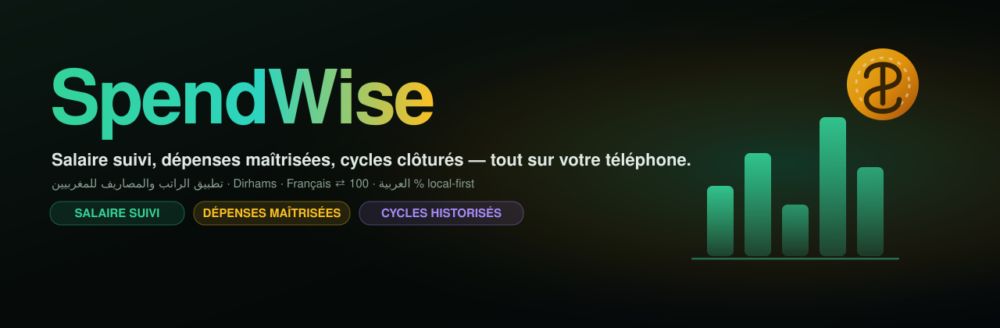
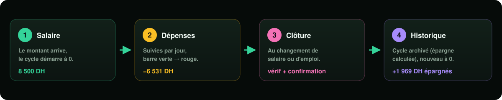
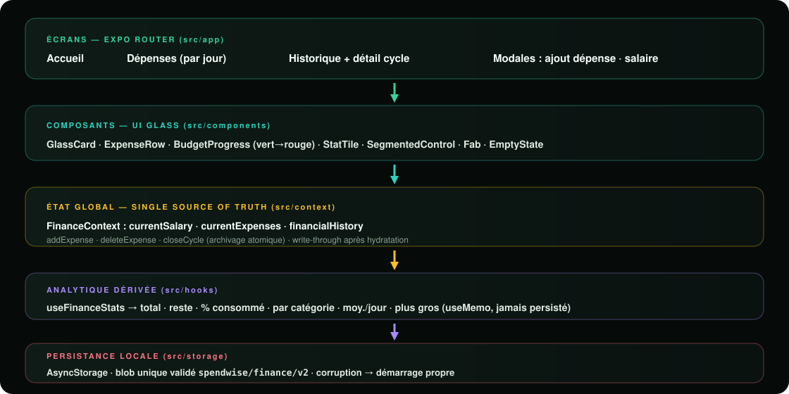

<div align="center">



# SpendWise

**Le gestionnaire de salaire et de dépenses pour le Maroc** — suivi du revenu actif,
dépenses groupées par jour, cycles financiers clôturés et archivés, 100 % local-first.

[](https://reactnative.dev)
[](https://expo.dev)
[](https://www.typescriptlang.org)
[](https://docs.expo.dev/router)
[](https://docs.expo.dev)
[](LICENSE)

[**Aperçu**](#-aperçu) · [**Fonctionnalités**](#-fonctionnalités) · [**Stack**](#-stack-technique) · [**Démarrage**](#-démarrage-rapide) · [**Architecture**](#-architecture) · [**Données**](#-modèle-de-données) · [**Roadmap**](#-roadmap)

</div>

---

## ✨ Aperçu

SpendWise suit **le cycle financier complet** d'un salarié marocain — sans compte, sans serveur :

1. **Le salaire arrive** → un cycle s'ouvre à **0 DH dépensé** (fresh install = tout à zéro).
2. **Les dépenses sont suivies** au fil des jours, avec une barre de consommation animée **vert → jaune → rouge**.
3. **Un changement de salaire ou d'emploi** clôture le cycle : confirmation, archivage automatique (dépenses + épargne calculée), nouveau cycle à zéro.
4. **Historique complet** : chaque mois clos est consultable — salaire, total dépensé, épargne, liste exacte des dépenses.

Interface **sombre glassmorphic** (cartes translucides, halos émeraude/or), bilingue **Français ⇄ العربية** avec **RTL complet**, montants en **dirhams** via `Intl.NumberFormat('fr-MA' | 'ar-MA')`.

## 🎯 Cycle financier

<div align="center">

</div>

## 🧩 Fonctionnalités

| # | Fonctionnalité | Détail |
|---|---|---|
| 💶 | **Salaire actif** | Carte héro : entreprise, montant, date d'effet, badge ACTIF |
| 📊 | **Consommation du salaire** | Barre animée **vert → jaune → rouge** (< 60 % / < 85 % / ≥ 85 %) + % consommé |
| 📅 | **Cycle en cours** | Progression `Jour X sur 31` + moyenne/jour + plus grosse dépense |
| 🧾 | **Dépenses groupées par jour** | Sections Aujourd'hui / Hier / date, recherche, chips par catégorie |
| 🔁 | **Clôture de cycle** | Archivage atomique : cycle courant → historique, nouveau cycle **à 0** |
| 🗂 | **Historique & rétrospective** | Épargne cumulée, meilleur cycle, détail par mois (salaire, dépensé, épargné, dépenses) |
| 🌐 | **Bilingue FR / AR** | RTL complet (`I18nManager` + reload), parité de clés garantie par TypeScript |
| 🇲🇦 | **Conçu pour le Maroc** | MAD/DH partout, `fr-MA` / `ar-MA`, 10 catégories de dépenses pertinentes |
| 🔒 | **100 % local-first** | Aucune donnée ne quitte le téléphone — AsyncStorage, zéro compte, zéro serveur |
| ✅ | **Validation & erreurs** | Montants > 0, dates AAAA-MM-JJ, payload AsyncStorage validé (corruption → démarrage propre) |

## 🛠 Stack technique

| Couche | Choix | Pourquoi |
|---|---|---|
| Framework | **Expo SDK 58** · React Native 0.88 | Expo Go, CNG, un seul codebase Android/iOS/Web |
| Navigation | **Expo Router** (file-based, `src/app`) | Routes typées (`experiments.typedRoutes`), modales natives |
| Langage | **TypeScript strict** | Zéro `any`, parité FR/AR forcée à la compilation |
| UI | **StyleSheet + LinearGradient** | Glassmorphism 100 % custom, aucun runtime CSS |
| Icônes | `@expo/vector-icons` (Ionicons) | Inclus dans Expo Go |
| Persistance | **AsyncStorage** — blob unique versionné et validé | Écriture atomique, validation du payload, migration par version |
| État | **React Context** (`FinanceContext`) | Source de vérité unique, write-through après hydratation |
| Analytics dérivées | `useFinanceStats` (`useMemo`) | Jamais persistées — toujours recalculées, jamais incohérentes |
| Feedback | `expo-haptics` | Confirmations tactiles (ajout, clôture, bascules) |
| i18n | **Maison** (`src/i18n`) | Dictionnaire typé `Record<TranslationKey, string>` — clé manquante = erreur de build |

## 🚀 Démarrage rapide

**Prérequis** : Node ≥ 20, npm, et Expo Go (téléphone) **ou** un émulateur Android / simulateur iOS.

```bash
git clone https://github.com/aminelebrini/SpendWise.git
cd SpendWise
npm install
npx expo start
```

Puis `a` (Android), `i` (iOS, macOS), `w` (web), ou **scannez le QR** avec Expo Go.

```bash
npx tsc --noEmit     # typecheck strict
npx expo-doctor      # santé des dépendances → 20/20
npx expo export      # bundle de production (android + iOS + web)
```

### Scripts

| Script | Rôle |
|---|---|
| `npm start` | Démarre Metro (`expo start`) |
| `npm run android` / `ios` / `web` | Cible directe |
| `npx tsc --noEmit` | Typecheck |
| `npx expo-doctor` | Diagnostic complet (dépendances, config) |

## 🏗 Architecture

<div align="center">

</div>

Principes :

- **Une seule source de vérité** (`FinanceContext`) — les écrans ne lisent jamais AsyncStorage.
- **Hydratation avant persistance** — l'écriture (`saveFinanceState`) n'a lieu qu'après la première lecture, donc jamais de réécrasement accidentel de vos données.
- **Clôture de cycle atomique** — calcul du total, archivage, reset du cycle courant, le tout dans une seule mise à jour d'état → un seul write AsyncStorage.
- **Pas de cycle fantôme** — une clôture sans salaire ni dépenses n'archive rien (premier salaire = onboarding, pas une clôture).
- **Blob unique versionné** (`spendwise/finance/v2`) — lecture validée à l'exécution ; payload corrompu → log + démarrage propre, pas de crash.

## 📁 Structure du projet

```
SpendWise/
├── docs/assets/            # Bannière & diagrammes (SVG)
├── src/
│   ├── app/                # ── Routes Expo Router ──────────────────────────
│   │   ├── _layout.tsx         # Stack + LanguageProvider + FinanceProvider
│   │   ├── (tabs)/             # Accueil · Dépenses · Historique (barre flottante glass)
│   │   ├── add-expense.tsx     # Modal — nouvel expense (titre, DH, catégorie, date)
│   │   ├── update-salary.tsx   # Modal — clôture de cycle (salaire / job change)
│   │   └── history/[cycleId].tsx  # Rétrospective d'un cycle archivé
│   ├── components/         # GlassCard · ExpenseRow · BudgetProgress · StatTile · Fab…
│   ├── constants/          # theme.ts (design system) · categories.ts (10 catégories)
│   ├── context/            # FinanceContext.tsx — état global + clôture de cycle
│   ├── hooks/              # useFinanceStats.ts — analytique dérivée (useMemo)
│   ├── i18n/               # runtime · translations.ts (FR/AR) · index.tsx (provider RTL)
│   ├── storage/            # financeStorage.ts — blob validé, atomique, versionné
│   ├── types/              # SalaryCycle · Expense · ClosedCycle · FinanceState
│   └── utils/              # format.ts (MAD, dates) · cycle.ts (cycles, regroupement/jour)
└── assets/                 # Icône app, splash, adaptive icon
```

## 🧠 Modèle de données

```ts
currentSalary:    { id, amount, company, startDate, isActive } | null   // salaire actif
currentExpenses:  [{ id, title, amount, category, date }]               // cycle en cours
financialHistory: [{ cycleId, company, salary, startDate, endDate,
                     totalExpenses, savedAmount, expensesList }]         // cycles clôturés
```

Persistance (`@react-native-async-storage/async-storage`) — clés versionnées :

| Clé | Contenu |
|---|---|
| `spendwise/finance/v2` | Blob complet `FinanceState` (écritures atomiques, validé à la lecture) |
| `spendwise/lang/v1` | Langue UI persistée (`fr` \| `ar`) |

## 🎨 Design system

Tokens centralisés dans `src/constants/theme.ts` — fond quasi noir teinté vert, halos
**émeraude / ambre / teal**, cartes `rgba(255,255,255,0.045)` + hairline `rgba(255,255,255,0.09)`,
border-radius 18–24, typographie system `800` pour les montants, chiffres `tabular-nums`.
La barre de consommation passe **vert → jaune → rouge** selon l'usage du salaire.

## 🌍 Internationalisation

- Dictionnaire typé `fr` / `ar` — `ar` est un `Record<TranslationKey, string>`
  → **une clé manquante dans une langue = erreur TypeScript**.
- `I18nManager.forceRTL` + `expo-updates` (`reloadAsync`) au changement de langue ;
  la direction est appliquée **avant le premier rendu** (pas de flash LTR).
- Tous les textes sont externalisés — y compris labels d'accessibilité et erreurs de formulaire.
- `Intl.NumberFormat('fr-MA' | 'ar-MA', …)` pour montants, dates et mois (hors input `YYYY-MM-DD`).

## ✅ Qualité

| Vérification | Résultat |
|---|---|
| `npx tsc --noEmit` (strict) | ✅ propre |
| `npx expo-doctor` | ✅ **20/20** |
| `npx expo export` android · iOS · web | ✅ 11 routes statiques |
| Expo Go (Expo SDK 58) | ✅ sans code natif custom |

## 🗺 Roadmap

- [ ] Budget par catégorie + alertes (« Loisirs » dépassés)
- [ ] Export CSV / PDF du cycle (partage)
- [ ] Graphes tendance (6 mois glissants)
- [ ] Notifications locales (veille de clôture de cycle)
- [ ] Migration MMKV (plus rapide que AsyncStorage)
- [ ] Widgets d'écran d'accueil (solde restant)

## ❓ FAQ

**Où sont mes données ?** Uniquement sur votre téléphone (AsyncStorage). Rien n'est envoyé nulle part.

**L'app fonctionne-t-elle hors-ligne ?** Oui — elle est intégralement offline.

**Pourquoi démarrer à zéro ?** Un salaire 0 n'est jamais archivé : votre premier
salaire sert de configuration, pas de « clôture ».

**Je veux réinitialiser mes données ?** Supprimez l'app (ou effacez le stockage) —
la réinstallation repart d'un état zéro.

## 👤 Auteur

**Amine Lebrini** — Développeur Full Stack (Laravel · FastAPI · React Native)

[](https://github.com/aminelebrini)
[](https://www.linkedin.com/in/aminelebrini)
[](mailto:aminelebrini26@gmail.com)

## 📄 Licence

[MIT](LICENSE) — faites-en bon usage.
